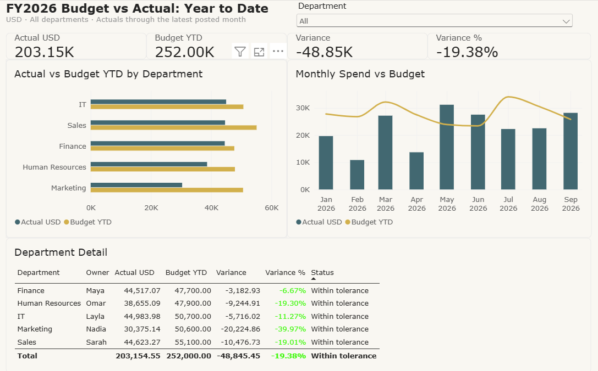

# FY2026 Multi-Currency Budget vs Actual Model

A budget vs actual model for 5 departments spending in three currencies (USD, EUR, LBP). It converts the general ledger to USD at monthly rates, reports year-to-date variances by department, forecasts full-year spending under three scenarios, and presents the results in an interactive Power BI dashboard.

📥 **[Download the Excel model](https://github.com/Rimahmallak/FY2026-Budget-Model/raw/main/FY2026_Budget_vs_Actual_Model.xlsx)**

> All data is fictional. Actuals: January–September 2026. Budget: January–December 2026.



## Key finding
Year to date, every department is under budget (**−19.38%** overall). The monthly view shows that **May and June were overspend months**: in May, IT (+89%), Marketing (+81%), Finance (+28%) and Sales (+9%) all spent above budget. Marketing is about 40% under budget for the year, yet 81% over in May. A single YTD variance hides this; the dashboard shows it in one click.

## Built in four stages, one answer
The same results were rebuilt with each tool and reconciled to the original formula model with zero difference.

| Check (YTD to 30 Sep 2026) | v1 Excel | v2 Power Query | v3 SQL | v4 Power BI |
|---|---|---|---|---|
| Transactions | 150 | 150 | 150 | 150 |
| Actual spend (USD) | 203,154.55 | 203,154.55 | 203,154.55 | 203,154.55 |
| Budget YTD (USD) | 252,000.00 | – | 252,000.00 | 252,000.00 |
| Variance % | −19.38% | – | −19.38% | −19.38% |

### v1: Excel model (built by hand with formulas)
- Ledger cleaning: mixed date formats fixed, codes standardised (`UPPER(TRIM())`), duplicates removed (152 → 150 rows)
- FX conversion with a two-key `XLOOKUP` (currency + month) and a flag for missing rates
- YTD budget vs actual with `SUMIFS`, status against a 10% tolerance
- Full-year forecast with Best / Base / Worst scenarios selected from a drop-down
- Reconciliation checks rolled up into one **All checks passed** flag

### v2: Power Query pipeline
- Combines monthly ledger exports from one folder; month-end = drop in the new file and **Refresh All**
- Automates the v1 cleaning, de-duplication and FX merge (currency + month)
- Reconciled to v1: rows, local totals by currency and USD total all match

### v3: SQL before Power Query (`sql/` folder)
- SQLite database with ledger, FX rates, budget and departments tables
- One query built in steps with CTEs: joins on currency and month, budget vs actual by department, total row, variance % as a ratio of totals, status with `CASE`
- Result loaded into the workbook with Power Query (**Report_SQL** sheet) and checked against the formula report

### v4: Power BI dashboard (`powerbi/` folder)
- Star-schema data model: ledger and budget (facts) linked to departments and a DAX Date table (dimensions)
- Every reported number is a DAX measure: Actual, Budget YTD (rolls forward automatically to the last posted month), Variance, Variance % (`DIVIDE`), Status
- Dashboard: KPI cards, department and monthly comparisons, detail table with budget owners, red/green variance flags, department slicer and cross-filtering
- A separate check page reconciles the dashboard to v1 to the cent

<details>
<summary><b>Show the DAX measures</b></summary>

```DAX
Actual USD = SUM(tblLedgerPQ[Amount USD])

Total Budget USD = SUM(tblBudget[Budget USD])

Budget YTD =
VAR Cutoff =
    CALCULATE ( MAX ( tblLedgerPQ[Date] ), ALL ( tblLedgerPQ ) )
RETURN
    CALCULATE ( [Total Budget USD], KEEPFILTERS ( 'Date'[Date] <= Cutoff ) )

Variance = [Actual USD] - [Budget YTD]

Variance % = DIVIDE([Variance], [Budget YTD])

Status =
VAR Tolerance = 0.10
RETURN
    IF (
        [Budget YTD] = 0,
        "No budget",
        IF ( [Variance %] > Tolerance, "Over tolerance", "Within tolerance" )
    )
```
</details>

## How to use the workbook
1. Pick a scenario (**Best / Base / Worst**) on the **Inputs** sheet.
2. Read the results on **Summary**; details are on **Report** (year to date) and **Forecast** (full year).
3. Confirm **All checks passed = OK** on the **Checks** sheet.

Excel may show *"External data connections have been disabled"* when opening the file. All results display without enabling it; refreshing needs the original source files, which are not included.

## Conventions and limitations
- **Variance** = Actual − Budget; positive means overspend. **Status** = "Over tolerance" above 10%, otherwise "Within tolerance".
- The forecast run rate ignores seasonality and one-off costs; each month's supplied FX rate is used as is.
- The Power BI `.pbix` file is not included; the screenshot shows the report and the measures are listed above.

---

**Rimah Mallak** · [LinkedIn](https://www.linkedin.com/in/rimah-mallak)
